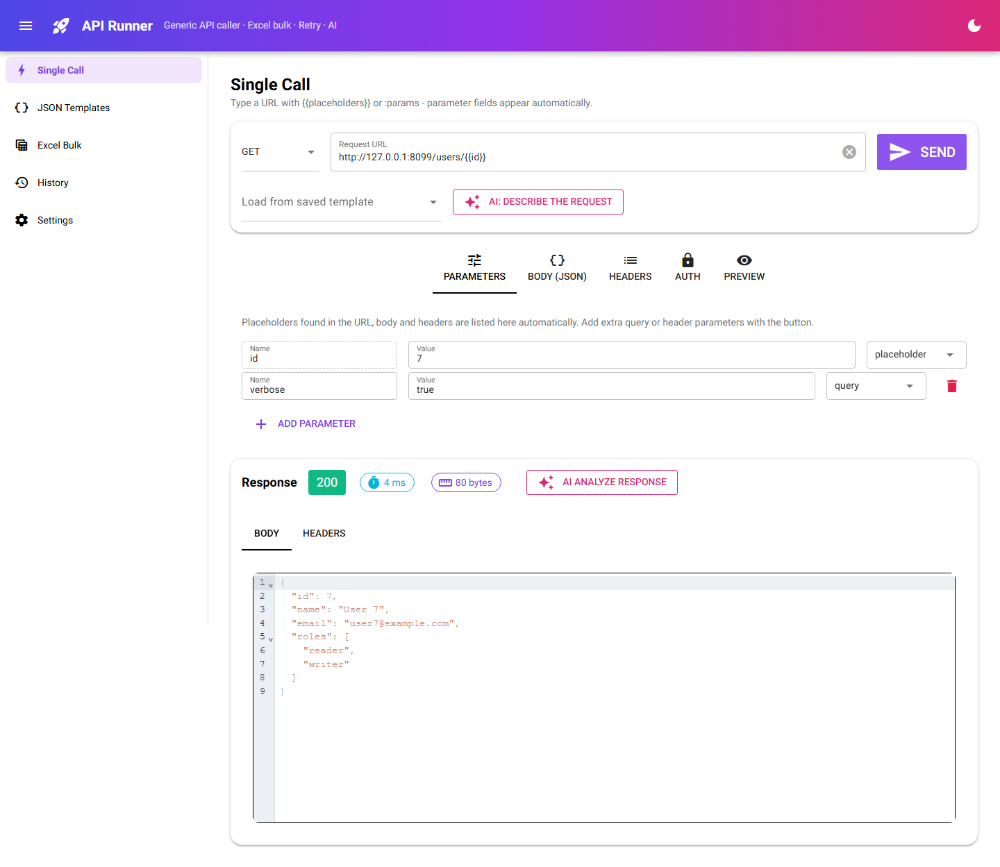
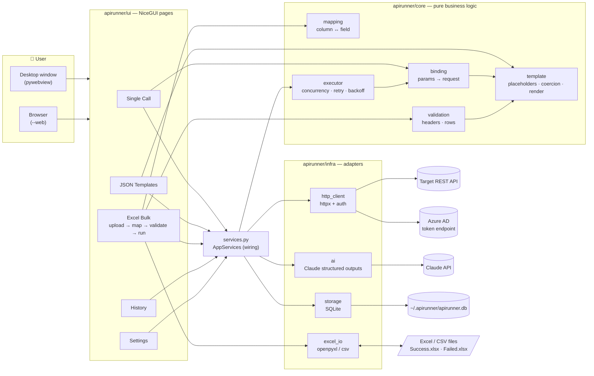
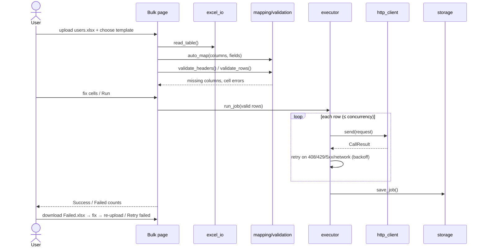
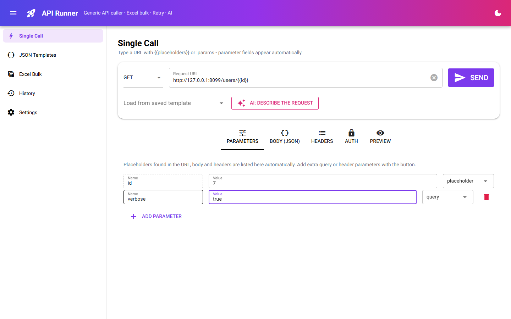
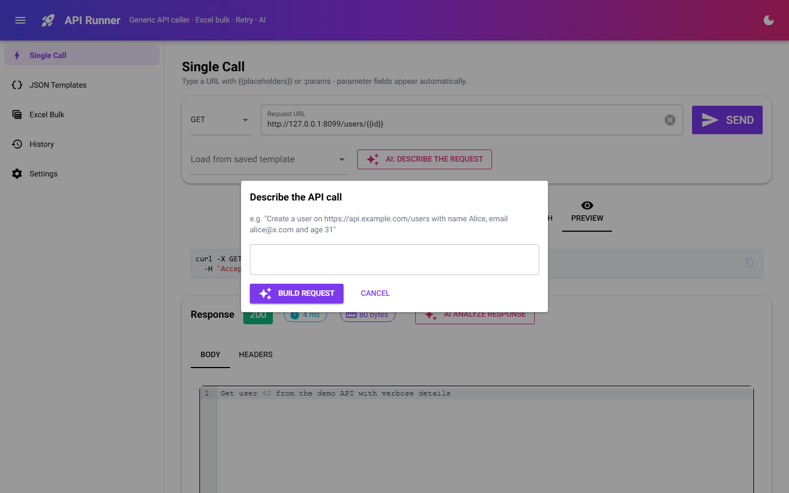
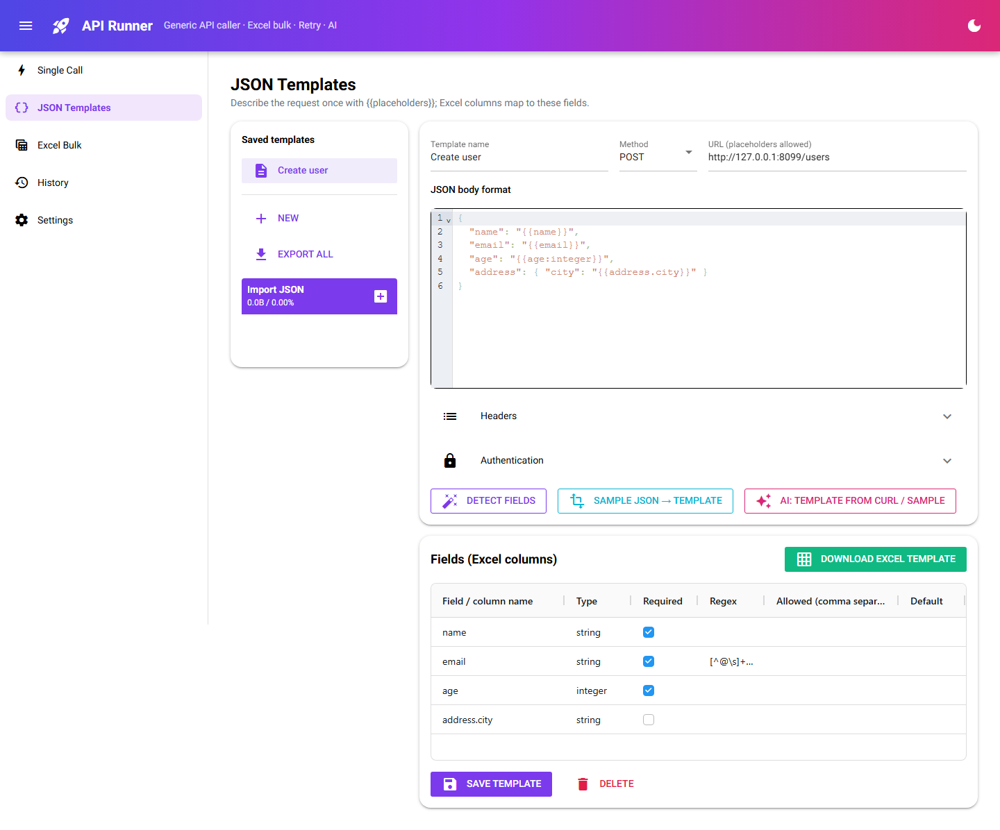
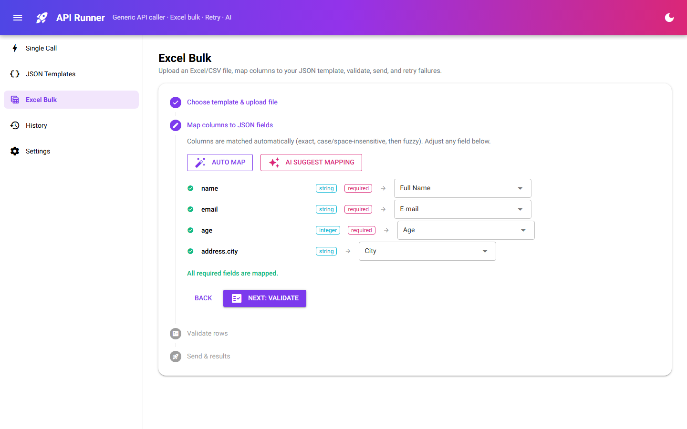
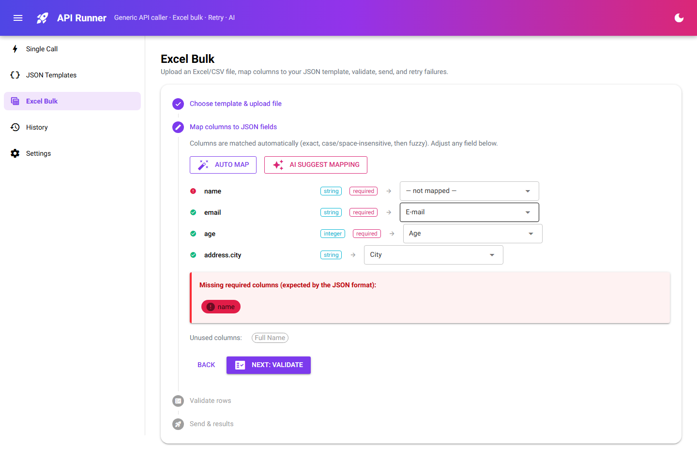
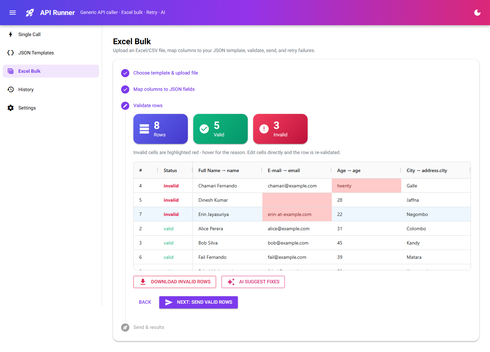
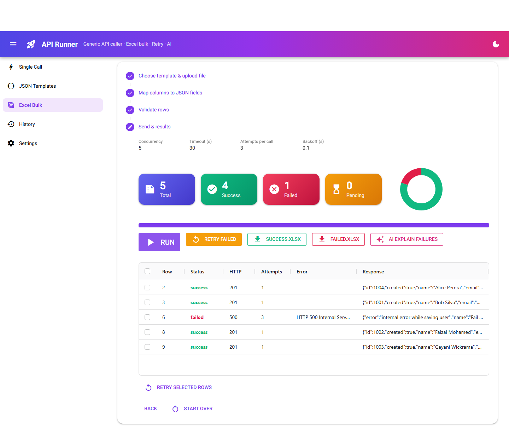

# API Runner

[](https://ci.appveyor.com/project/PasinduUmayanga/excel-api-calls-using-azure-microsoft-access-token-sample)


**API Runner** is a generic tool for calling any REST API, either one request at a time or in bulk from
Excel. It works with any API because you describe the request once as a **JSON template** with
`{{placeholders}}`. The app then:

- shows a value field for each placeholder when you make a single call
- matches Excel columns to the placeholders for bulk sends and checks every row before sending
- retries failed calls automatically, and lets you retry them again with one click
- gives you the successful and failed rows as **separate Excel files**. `Failed.xlsx` can be uploaded again as-is.
- uses **AI (Claude)** to build requests, explain responses, match columns, suggest fixes and group failures

It runs as a **desktop window** (pywebview) or in the **browser** from the same code.



---

## Contents
- [Features](#features)
- [System diagram](#system-diagram)
- [Quick start](#quick-start)
- [How to use it](#how-to-use-it)
- [Template syntax](#template-syntax)
- [Technology](#technology)
- [Project structure](#project-structure)
- [Testing](#testing)
- [CI (AppVeyor)](#ci-appveyor)
- [Documentation](#documentation)

## Features

| Area | What you get |
|---|---|
| **Single call** | Method + URL + JSON body. Any `{{name}}` or `:name` in the URL, body or headers becomes a **parameter row automatically**: you enter the value and it is filled in for you. Extra query or header parameters can be added by hand. Live curl preview. Response shows status badge, time, size, formatted JSON and headers. |
| **JSON templates** | Save reusable request templates. Fields are detected from the placeholders, and each can have a type, required flag, regex, allowed values and default. Paste sample JSON to turn it into a template. **Download an Excel template** whose header row matches the fields exactly. Import and export templates as JSON. |
| **Excel bulk** | Upload `.xlsx`, `.xlsm` or `.csv` (any sheet). **Columns are matched automatically**: exact name, then ignoring case and spaces, then fuzzy, then containment (e.g. *Full Name* → `name`). **Validation**: lists missing required columns and unused columns, highlights invalid cells red with the reason, and lets you edit cells inline (the row is checked again). Download the invalid rows. |
| **Run & retry** | Send in parallel with a concurrency limit, a timeout, and automatic retries with exponential backoff (on 408/429/5xx and network errors). Live **Success / Failed / Pending** counters, a donut chart and a progress bar. Download **Success.xlsx** and **Failed.xlsx** separately. **Retry failed**, or retry selected rows. |
| **History** | Every run is saved. Download its results again or retry its failures later. |
| **Auth** | None, Bearer, API key (header or query), Basic, or **Azure AD / Microsoft Entra client credentials**. The Azure token is cached until shortly before it expires. |
| **AI (optional)** | **Request**: describe a call in plain English and get a filled-in request. **Response**: outcome, summary, key values and next steps. **Bulk**: smart column matching, suggested fixes for invalid cells, failures grouped by cause. **Templates**: build one from a curl command, OpenAPI snippet or sample JSON. |
| **Look & feel** | Colourful gradient theme, Material icons, dark mode, coloured counter cards, AG Grid tables, ECharts chart. |

## System diagram



**Layering rule:** `core` has no I/O and imports nothing from `ui` or `infra`. The executor receives the
HTTP sender as a function (`Sender` protocol), so it can be tested with fake senders. `infra` contains the
adapters for HTTP, Excel, SQLite and AI. `ui` only talks to `services`, `core` and `infra` and holds no
business rules. See [docs/ARCHITECTURE.md](docs/ARCHITECTURE.md).

### Bulk flow



## Quick start

```bash
python -m venv .venv
.venv\Scripts\activate            # macOS/Linux: source .venv/bin/activate
pip install -e ".[dev]"

python -m apirunner               # desktop window
python -m apirunner --web         # browser at http://127.0.0.1:8765
```

Try it without a real API: run `python samples/mock_api.py` (a local demo API on port 8099) and
upload `samples/users.xlsx`. The file contains valid rows, invalid rows and rows the API rejects.

**AI (optional):** set `ANTHROPIC_API_KEY`, or paste a key on the **Settings** page. The default model is
`claude-opus-5-5`; you can change it in Settings or with `APIRUNNER_AI_MODEL`. When no key is set, the
AI buttons are hidden and everything else still works.

| Environment variable | Purpose | Default |
|---|---|---|
| `ANTHROPIC_API_KEY` | Turns on AI features | – |
| `APIRUNNER_AI_MODEL` | Claude model id | `claude-opus-5-5` |
| `APIRUNNER_DATA_DIR` | Location of the SQLite database | `~/.apirunner` |
| `APIRUNNER_HOST` / `APIRUNNER_PORT` | Web server address | `127.0.0.1` / `8765` |

## How to use it

### 1. Single call: parameters fill in automatically
Type `https://api.example.com/users/{{id}}`. An `id` row appears under **Parameters**. Enter the value
and click **Send**. Use **Add parameter** for extra query or header parameters.



**AI: describe the request** builds the call from plain English. After a response, **AI analyze
response** explains what came back and what to do next.



### 2. Define the JSON format once
Write the body your API expects, using placeholders. Click **Detect fields**, set the types and rules,
then **Save template**. Click **Download Excel template** to get a sheet with exactly these column names.



### 3. Bulk send from Excel
Upload the file. Columns are matched to fields automatically, and any required field without a column
is reported straight away:

| Auto mapping | Missing required column |
|---|---|
|  |  |

The validation step highlights each invalid cell and gives the reason:



### 4. Results, downloads and retry
Watch the live counters. Then download **Success.xlsx** and **Failed.xlsx** separately, or click
**Retry failed**. A failed row has already been retried automatically before it is reported (the
*Attempts* column shows how many times).



The full walkthrough of every screen is in the **[User Manual](docs/USER_MANUAL.md)**.

## Template syntax

| Syntax | Meaning | Example |
|---|---|---|
| `{{name}}` | String field | `"name": "{{name}}"` |
| `{{name:type}}` | Typed field: `string`, `number`, `integer`, `boolean`, `date`, `array`, `object` | `"age": "{{age:integer}}"` → `"age": 31` |
| `{{a.b}}` | Dotted field name, useful for nested JSON | `"address": {"city": "{{address.city}}"}` |
| `:name` | Path parameter in the URL | `/users/:id` |
| `"Hi {{name}}"` | Placeholder inside a longer string is inserted as text | `"Hi Ann"` |

A string that contains **only** one placeholder keeps the value's type: `"{{age:integer}}"` becomes the
number `31`, not the text `"31"`. Values placed in the URL are URL-encoded.

## Technology

| Concern | Technology | Why |
|---|---|---|
| Language | **Python 3.12** | One language for the UI, logic and tests |
| UI framework | **NiceGUI 3** (Vue + **Quasar** Material components, **Tailwind** utilities) | Modern, colourful components written in Python; runs as a desktop app or web app |
| Desktop shell | **pywebview** (Edge WebView2 on Windows) | Native window without a separate browser |
| Grids & charts | **AG Grid**, **ECharts**, **CodeMirror** (bundled with NiceGUI) | Editable tables, donut chart, JSON editors |
| HTTP | **httpx** (async) | Parallel calls, timeouts, HTTP/1.1 |
| Models & validation | **Pydantic v2** | Typed models, JSON (de)serialisation |
| Excel | **openpyxl** (+ `csv`) | Read and write `.xlsx` with styling, comments and dropdowns |
| Fuzzy matching | **RapidFuzz** | Fast column-name matching |
| Storage | **SQLite** (standard library) | Templates, job history and settings with no setup |
| AI | **Anthropic Python SDK**: Claude with **structured outputs** (`messages.parse` + Pydantic) | Answers always parse into typed objects |
| Auth | Bearer, API key, Basic, **Azure AD client credentials** | Covers most enterprise APIs |
| Tests | **pytest**, pytest-asyncio, **respx**, NiceGUI `User` simulation, **Playwright** | Unit, adapter, UI and end-to-end tests |
| CI | **AppVeyor** with a pip and virtualenv cache | Windows build that runs the test suite |

## Project structure

```
apirunner/
  core/            pure business logic (no I/O)
    models.py      Pydantic domain models (templates, params, jobs, results, retry policy)
    template.py    placeholder parsing, type coercion, rendering URL/body
    binding.py     parameter detection & binding -> PreparedRequest, curl preview
    mapping.py     Excel column -> field auto-mapping
    validation.py  header & row validation
    executor.py    concurrency, retry/backoff, jobs, retry-failed
  infra/           adapters
    http_client.py httpx sender + auth (Bearer, API key, Basic, Azure AD)
    excel_io.py    read xlsx/csv, write template / Success / Failed / Invalid workbooks
    storage.py     SQLite templates, jobs, settings
    ai.py          Claude assistant (structured outputs)
  services.py      wiring used by the UI
  ui/              NiceGUI pages + theme + widgets
  app.py           entry point (desktop / --web)
samples/           mock API + demo Excel file
tests/             pytest suite (71 tests)
tools/             Playwright walkthrough that captures the screenshots
docs/              architecture, business logic, user manual, images
AGENTS.md          guide for AI coding agents / contributors (+ per-folder AGENTS.md)
```

## Testing

```bash
pytest                                  # 71 tests, about 10 s
pytest --cov=apirunner                  # with coverage
python tools/capture_screenshots.py     # end-to-end walkthrough in a real browser (needs: playwright install chromium)
```

| Suite | Covers |
|---|---|
| `test_template.py` | placeholder parsing, type conversion, typed body rendering, URL encoding, sample-to-template |
| `test_binding.py` | parameter detection and sync, query/header routing, GET without a body, curl preview |
| `test_mapping_validation.py` | exact, normalised, fuzzy and containment mapping; missing and unused columns; cell errors |
| `test_executor.py` | retry on 5xx and network errors, no retry on 4xx, exponential backoff, concurrency limit, retry only failed rows |
| `test_excel_io.py` | reading xlsx/csv, template headers, notes and dropdowns, Success/Failed split, **re-uploading Failed.xlsx**, invalid-row export |
| `test_http_storage_ai.py` | httpx sender, all auth types, Azure token caching, SQLite storage, AI structured output (mocked), at most 5 sample rows sent, refusal handling |
| `test_ui.py` | every page renders, parameters are detected automatically in the UI, AI buttons hidden without a key, bulk page template list |

Coverage: `core` 89–100 %, `infra` 84–100 %.

## CI (AppVeyor)

[`appveyor.yml`](appveyor.yml):
1. Uses the Windows image with Python 3.12.
2. **Caches** the pip download cache and the `.venv`. Both caches are cleared whenever `pyproject.toml` changes.
3. Installs the package with its dev extras.
4. Runs `pytest` with JUnit XML and coverage output.
5. **Publishes the test results** to the AppVeyor *Tests* tab, even when the run fails.
6. Uploads `test-results.xml` and `coverage.xml` as artifacts.

## Documentation

| Document | Contents |
|---|---|
| [docs/USER_MANUAL.md](docs/USER_MANUAL.md) | Step-by-step guide to every screen, with screenshots |
| [docs/BUSINESS_LOGIC.md](docs/BUSINESS_LOGIC.md) | Rules for placeholders, binding, mapping, validation, retry, result files and AI |
| [docs/ARCHITECTURE.md](docs/ARCHITECTURE.md) | Layers, modules, technologies, data model, extension points |
| [AGENTS.md](AGENTS.md) | Conventions and commands for AI coding agents and contributors |
