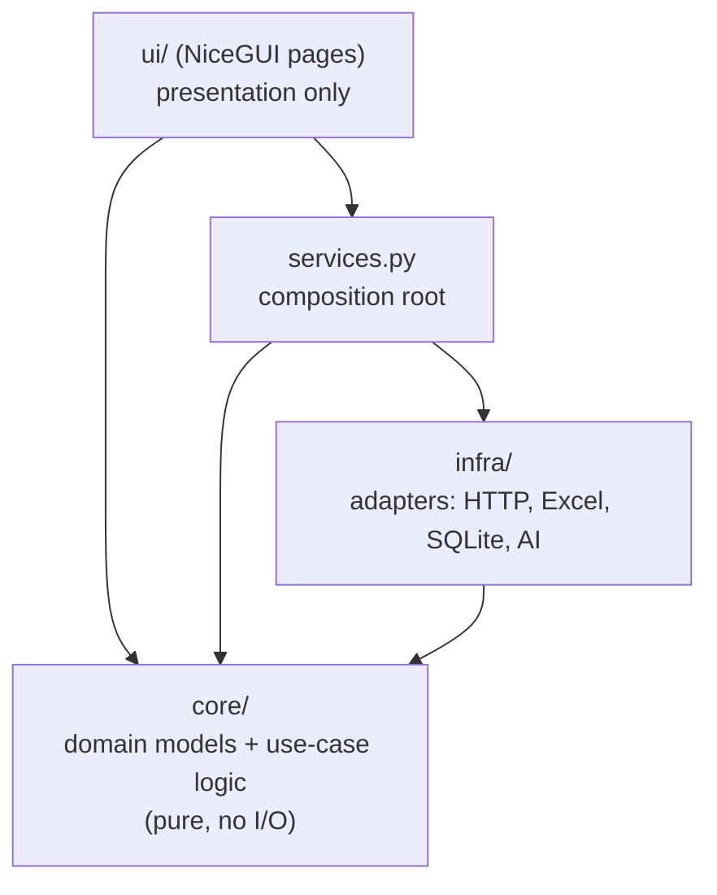
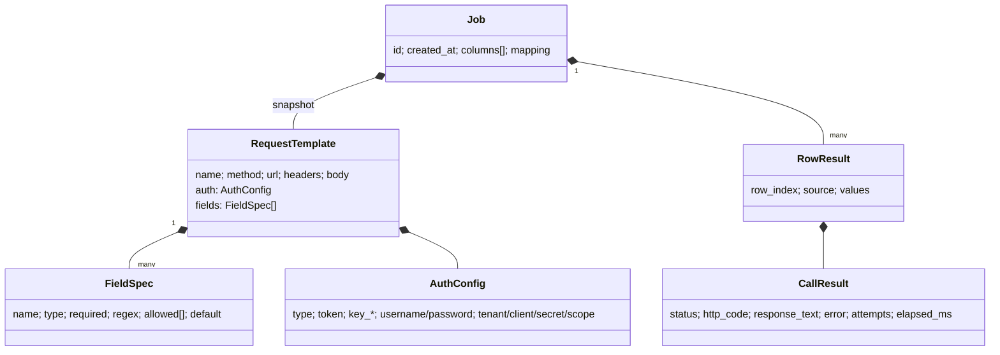

# Architecture & Technologies

## Style

**Clean / hexagonal layering**, with each UI page owning one feature:

| Layer | May import | Must not import | Reason |
|---|---|---|---|
| `core` | stdlib, pydantic, rapidfuzz | `infra`, `ui`, nicegui, httpx, openpyxl, anthropic | Stays pure and fast to unit test. The rules live in one place |
| `infra` | `core`, its own libraries | `ui` | Adapters can be swapped (e.g. Postgres instead of SQLite) without touching the rules |
| `services.py` | `core`, `infra` | `ui` | Connects the adapters to the use cases (composition root) |
| `ui` | everything above | – | Thin. Holds page state and display logic only |

**Dependency inversion:** `core.executor` defines a `Sender` protocol,
`(PreparedRequest, timeout) -> Awaitable[CallResult]`. `infra.http_client.HttpSender` implements it. The
tests pass simple fake senders, and a different transport (gRPC, a queue) would only need a new sender.

## Modules

| Module | Responsibility | Key API |
|---|---|---|
| `core/models.py` | Pydantic domain models | `RequestTemplate`, `FieldSpec`, `AuthConfig`, `Param`, `PreparedRequest`, `RetryPolicy`, `RunOptions`, `CallResult`, `RowResult`, `Job` |
| `core/template.py` | Placeholders, type conversion, rendering | `extract_placeholders`, `extract_fields`, `coerce`, `render_url`, `render_body`, `sample_json_to_template` |
| `core/binding.py` | Parameters → request | `detect_param_names`, `sync_params`, `build_request`, `bind_single`, `to_curl` |
| `core/mapping.py` | Column ↔ field matching | `auto_map`, `usable_columns` |
| `core/validation.py` | Header and row rules | `validate_headers`, `validate_rows` |
| `core/executor.py` | Retry, concurrency, jobs | `call_with_retry`, `create_job`, `run_job`, `run_rows`, `retry_failed` |
| `infra/http_client.py` | httpx sender and authentication | `HttpSender`, `AzureTokenProvider` |
| `infra/excel_io.py` | Excel/CSV input and output | `read_table`, `write_template`, `write_results`, `write_invalid_rows` |
| `infra/storage.py` | SQLite | `Storage` (templates, jobs, settings, import/export) |
| `infra/ai.py` | Claude assistant | `AiAssistant` + Pydantic output schemas |
| `services.py` | Wiring | `services.storage`, `services.ai()`, `services.sender()`, `services.run()` |
| `ui/theme.py` | Palette, page frame, counter cards, status badge | `frame()`, `stat_card()` |
| `ui/widgets.py` | Auth editor, JSON editor, header parser | `AuthEditor`, `json_editor` |
| `ui/*_page.py`, `ui/single_call.py` | One page per feature | `page()` |
| `app.py` | Page registration, desktop or web start | `main()` |

## Data model

A job stores a **snapshot** of its template, so changing the template later does not affect how
history is retried.

SQLite tables (`~/.apirunner/apirunner.db`):
- `templates(name PK, data JSON)`
- `jobs(id PK, template_name, created_at, total, success, failed, data JSON)`
- `settings(key PK, value)`

## Runtime

- **NiceGUI** runs a FastAPI/uvicorn server. Each page is a Python function that builds Vue/Quasar
  components, and websockets keep the browser and Python in sync.
- **Desktop mode** (`native=True`) opens the same pages in a **pywebview** window. **Web mode** (`--web`)
  serves them to any browser.
- Bulk runs are `async`, so calls are sent at the same time on one event loop. A 0.3 s `ui.timer` copies
  the job's counts to the counter cards, chart, progress bar and grid while it runs.
- Long AI calls are `await`ed in the click handlers (async), so the UI keeps responding.

## Technologies

| Technology | Version | Used for |
|---|---|---|
| Python | 3.12 (≥ 3.11) | Everything |
| NiceGUI | 3.x | UI framework (Vue 3 + Quasar 2 + Tailwind), with AG Grid, ECharts and CodeMirror bundled |
| pywebview | 5+ | Desktop window (Edge WebView2 on Windows) |
| httpx | 0.27+ | Async HTTP client |
| Pydantic | 2.x | Models and JSON |
| openpyxl | 3.1 | Excel reading and writing (styles, comments, data validation) |
| RapidFuzz | 3.x | Fuzzy column matching |
| anthropic | 1.x | Claude API with structured outputs |
| SQLite | stdlib | Persistence |
| pytest / pytest-asyncio / respx | – | Unit and adapter tests |
| NiceGUI `User` fixture | – | UI tests without a browser |
| Playwright | 1.4x | End-to-end walkthrough and screenshots |
| AppVeyor | – | Windows CI with pip and virtualenv caching |

## Extension points

| To add… | Do this |
|---|---|
| A new field type | Add it to `FieldType`, `_VALID_TYPES` and `coerce()` in `core/template.py`, then add tests |
| A new auth scheme | Add an `AuthType` value and the fields it needs in `AuthConfig`, handle it in `HttpSender._apply_auth`, and add inputs in `ui/widgets.AuthEditor` |
| A new storage backend | Implement the `Storage` methods (e.g. with SQLAlchemy or Postgres) and inject it in `AppServices(storage=...)` |
| A new AI feature | Add a Pydantic output model and an `AiAssistant` method that calls `_ask(prompt, Model)`, then a button that only shows when `services.ai().enabled` |
| A new page | Add `ui/<name>_page.py` with `page()`, add it to `ROUTES` in `app.py` and to `NAV` in `ui/theme.py` |
| A new input format (JSON lines, Google Sheets) | Return a `Table` from a new reader in `infra/` |
