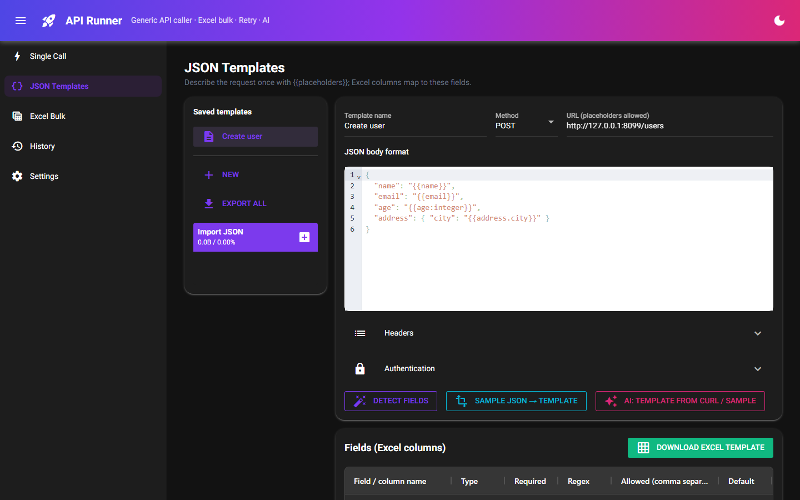
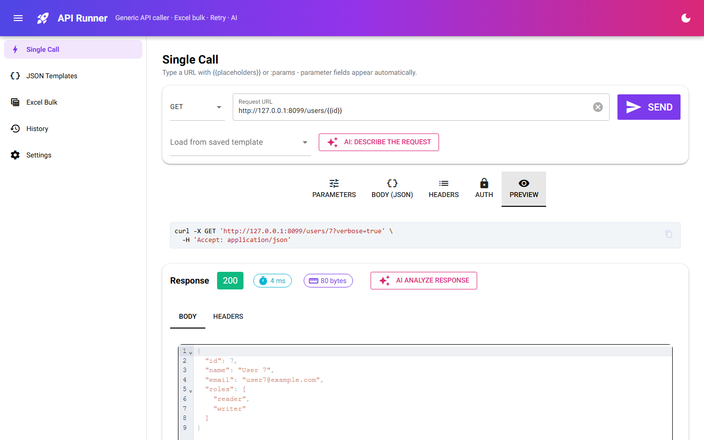
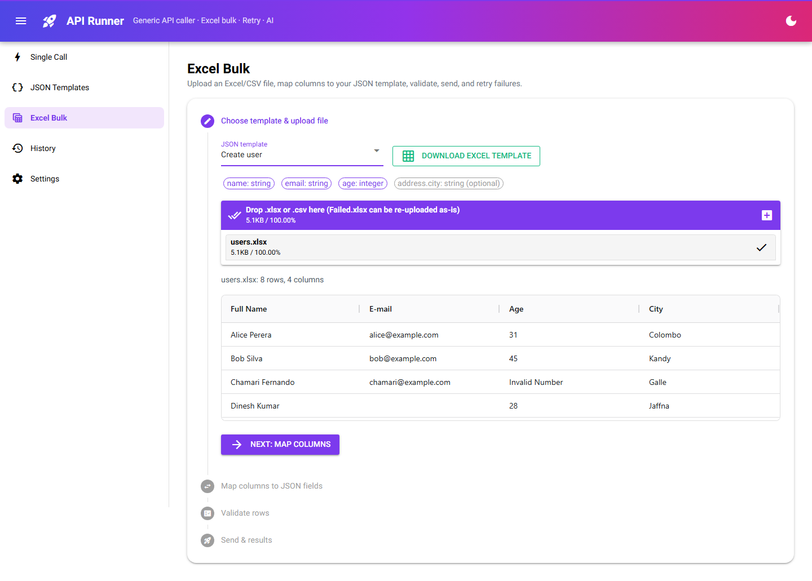
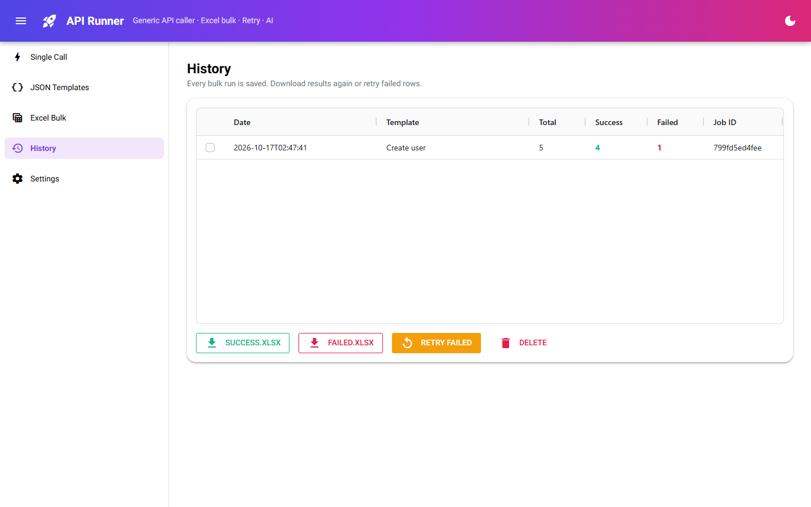
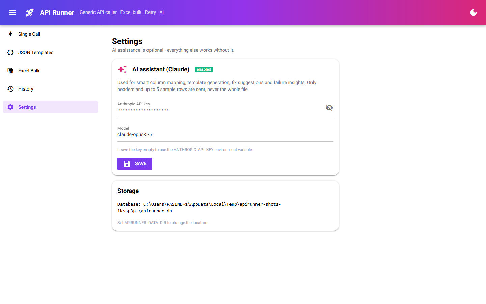

# API Runner: User Manual

This manual covers each screen in order. The screenshots were taken with
`tools/capture_screenshots.py`, which runs the app against the bundled demo API (`samples/mock_api.py`)
and the sample file `samples/users.xlsx`.

- [Starting the app](#starting-the-app)
- [Screen layout](#screen-layout)
- [1. Single Call](#1-single-call)
- [2. JSON Templates](#2-json-templates)
- [3. Excel Bulk](#3-excel-bulk)
- [4. History](#4-history)
- [5. Settings](#5-settings)
- [Common tasks](#common-tasks)
- [Troubleshooting](#troubleshooting)

---

## Starting the app

| Mode | Command |
|---|---|
| Desktop window | `python -m apirunner` |
| Browser | `python -m apirunner --web`, then open http://127.0.0.1:8080 |
| Demo API (optional) | `python samples/mock_api.py` (runs on http://127.0.0.1:8099) |

Templates, job history and settings are saved in `~/.apirunner/apirunner.db`. Set `APIRUNNER_DATA_DIR`
to store them somewhere else.

## Screen layout

- **Header:** the menu button shows or hides the side menu, and the moon button switches dark mode on or off.
- **Side menu:** Single Call, JSON Templates, Excel Bulk, History, Settings.
- **Purple-pink buttons marked ✨:** AI features. They only appear when an AI key is set (see [Settings](#5-settings)).



---

## 1. Single Call

Use this screen to send one request and inspect the response.

### 1.1 Build the request
1. Choose the **method** (GET, POST, PUT, PATCH, DELETE).
2. Type the **Request URL**. Put any value that changes in a placeholder: `{{id}}`, or `:id` in the path.
3. A row for each placeholder appears straight away on the **Parameters** tab. Enter its **Value**.
4. To send a parameter that is not in the URL, click **Add parameter**, type its **Name** and **Value**,
   and choose where it goes:
   - **query**: added as `?name=value`
   - **header**: sent as an HTTP header
   - **placeholder**: fills a matching `{{name}}`
5. To load a saved request, use **Load from saved template**.


| Tab | Use |
|---|---|
| **Parameters** | Placeholder values (detected automatically) and extra query or header parameters |
| **Body (JSON)** | Request body. Placeholders work here too. `"{{age:number}}"` sends a number, not a string |
| **Headers** | A JSON object such as `{"Accept": "application/json"}`, or `Key: Value` lines |
| **Auth** | None, Bearer token, API key (header or query), Basic, Azure AD client credentials |
| **Preview** | The exact request that will be sent, shown as a curl command |



### 1.2 Send and read the response
Click **Send**. The response panel shows:
- a **status badge**: green 2xx, blue 3xx, amber 4xx, red 5xx or a network error
- the **time** in milliseconds and the **size** in bytes
- **Body** (JSON is formatted for reading) and **Headers** tabs


### 1.3 AI help (optional)
- **AI: describe the request**: write what you want in plain English, for example *"Get user 42 with
  verbose details"*. The method, URL, parameters and body are filled in for you to check before sending.
- **AI analyze response**: after a call, gives the outcome (success, client error, auth error, …), a
  short summary, the most useful values (ids, totals, error codes) and suggested next steps.


---

## 2. JSON Templates

A template describes a request once, so that rows from Excel can fill it in. It acts as the agreement
between your spreadsheet and the API.


### 2.1 Create a template
1. Click **New** in the *Saved templates* panel, or edit the example.
2. Enter a **Template name**, the **Method** and the **URL**. The URL may contain placeholders.
3. Write the **JSON body format** with placeholders:
   ```json
   {
     "name": "{{name}}",
     "email": "{{email}}",
     "age": "{{age:integer}}",
     "address": { "city": "{{address.city}}" }
   }
   ```
4. Optionally open **Headers** and **Authentication**.
5. Click **Detect fields**. The **Fields** table lists every placeholder.
6. Adjust each field in the table:

   | Column | Meaning |
   |---|---|
   | Field / column name | The Excel column name this field expects |
   | Type | string, number, integer, boolean, date, array, object |
   | Required | Whether an empty cell makes the row invalid |
   | Regex | The value must match this pattern, e.g. `[^@\s]+@[^@\s]+` for an email |
   | Allowed | A comma-separated list of allowed values. The Excel template shows these as a dropdown |
   | Default | Used when the cell is empty |
7. Click **Save template**.

### 2.2 Shortcuts
- **Sample JSON → template**: paste a real payload, such as `{"name": "Ann", "age": 31}`, into the body
  and click this button. It becomes `{"name": "{{name}}", "age": "{{age:integer}}"}`.
- **AI: template from curl / sample** (✨): paste a curl command, an OpenAPI snippet or sample JSON, and
  the AI drafts the method, URL, headers and body template.
- **Download Excel template**: an `.xlsx` file whose header row matches the field names exactly. Each
  header has a note with its type and whether it is required, and allowed values appear as dropdowns.
- **Export all / Import JSON**: copy templates to another machine or share them with your team.

---

## 3. Excel Bulk

Send one API call per Excel row in four steps.

### Step 1: Choose template & upload file
1. Pick the **JSON template**. Chips show its fields (filled chips are required).
2. Optionally click **Download Excel template** to get a correctly formatted sheet.
3. Drop an **.xlsx, .xlsm or .csv** file onto the upload box. Workbooks with several sheets show a
   **Sheet** selector.
4. Check the preview (first 100 rows), then click **Next: map columns**.



### Step 2: Map columns to JSON fields
Columns are matched to fields automatically, in this order:
1. **exact** name
2. the same name **ignoring case and punctuation** (`E-mail` → `email`), including the last part of
   dotted names (`City` → `address.city`)
3. **fuzzy** match for typos (`Emial Adress` → `email_address`)
4. **containment** (`Full Name` → `name`)

Change any match with its dropdown. **AI suggest mapping** (✨) asks the AI to match columns using the
column names and 5 sample rows.


If a **required field has no column**, a red panel lists it and you cannot continue until it is mapped.
Columns that are not used by any field are listed in grey.


### Step 3: Validate rows
Every row is checked against the field rules: required, type, regex and allowed values.
- Counter cards show **Rows / Valid / Invalid**.
- Invalid rows are listed first. **Bad cells are red. Hover over one to see the reason**, e.g.
  `expected integer, got 'twenty'`.
- **Edit a cell directly in the table** and the row is checked again immediately.
- **Download invalid rows** creates `Invalid.xlsx` with the bad cells highlighted and an `_error`
  column. Fix it in Excel and upload it again.
- **AI suggest fixes** (✨) proposes corrected values, for example a date format or `yes` → `true`. Each
  suggestion has a checkbox, so you choose which ones to apply.


Click **Next: send valid rows**. Only valid rows are sent. Invalid rows stay here for you to fix.

### Step 4: Send & results
1. Set the run options:

   | Option | Meaning |
   |---|---|
   | Concurrency | How many calls run at the same time |
   | Timeout (s) | How long to wait for each attempt |
   | Attempts per call | 1 means no automatic retry. 3 means up to 2 retries |
   | Backoff (s) | Wait before the first retry. The wait doubles each time (0.5 → 1 → 2 s) |

   Automatic retries happen on HTTP **408, 429, 500, 502, 503, 504** and on **network errors**. Other
   4xx errors (such as 400 or 422) are not retried, because sending the same data again would fail again.
2. Click **Run**. The **Total / Success / Failed / Pending** counters, the donut chart and the progress
   bar update live.
3. Each row in the results table shows its HTTP code, number of attempts, error and response.


After the run:
- **Success.xlsx**: the rows that succeeded.
- **Failed.xlsx**: the rows that failed.

  Both files contain your original columns plus `_status`, `_http_code`, `_error`, `_response` and
  `_attempts`.
- **Retry failed**: sends only the failed rows again.
- **Retry selected rows**: tick rows in the table, then retry just those.
- **AI explain failures** (✨): groups failures by root cause and suggests how to fix each group.
- **Upload Failed.xlsx again**: fix the data in Excel and upload the file in Step 1. Columns starting
  with `_` are ignored, so the file maps and validates like the original.

---

## 4. History

Every bulk run is saved with its date, template and counts.



Select a job, then:
- **Success.xlsx / Failed.xlsx**: download its results again.
- **Retry failed**: retry its failed rows now, using the default options (3 attempts).
- **Delete**: remove the job.

---

## 5. Settings



- **Anthropic API key**: turns on the AI features (✨ buttons). If left empty, the
  `ANTHROPIC_API_KEY` environment variable is used.
- **Model**: the Claude model to use (default `claude-opus-5-5`).
- **Storage**: shows where the database is saved.

What the AI receives: for mapping, the column names and at most **5 sample rows**; for fixes, only the
invalid cells; for failures, the failed rows' errors and shortened responses; for responses, the request
you sent and the response body (shortened). The full Excel file is never uploaded.

---

## Common tasks

**Bulk-create records from a spreadsheet**
JSON Templates → write the body → Detect fields → Save → Excel Bulk → upload → Next → Next → Run.

**Re-send only the rows that failed**
After the run, click **Retry failed**. Or download Failed.xlsx, fix it, and upload it again.

**Call an API secured by Azure AD**
In Auth, choose *Azure AD (client credentials)* and enter the tenant ID, client ID, client secret and
scope (e.g. `https://graph.microsoft.com/.default`). The token is fetched once and reused until it
expires.

**Send an array or object from Excel**
Use `{{tags:array}}`. A cell containing `a, b, c` or `["a","b"]` becomes a JSON array. Use
`{{meta:object}}` with a cell that contains a JSON object.

## Troubleshooting

| Symptom | Cause / fix |
|---|---|
| ✨ buttons are missing | No AI key. Add one on the Settings page |
| "Map all required fields first" | A required field has no column. Map it, or make the field optional or give it a default in the template |
| Every row fails with `ConnectError` | The API cannot be reached. Check the URL, VPN or proxy |
| 401 / 403 on every row | Check the Auth settings in the template |
| 422 on some rows | The API rejected the data. Look at `_response` in Failed.xlsx or use **AI explain failures** |
| The desktop window does not open | Install Edge WebView2, or use `--web` |
